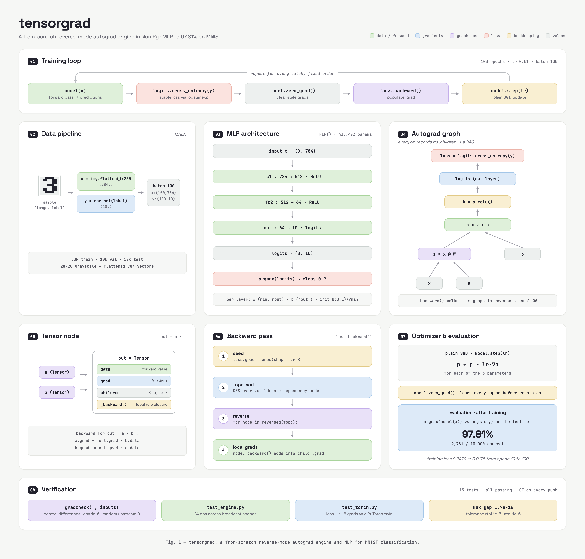

# tensorgrad

[](https://github.com/ColeAndrae/tensorgrad/actions/workflows/tests.yml)


[](LICENSE)

A reverse-mode autograd engine for tensors, written from scratch in NumPy. It trains a 784-512-64-10 MLP on MNIST to **97.8% test accuracy** with plain SGD, and its loss and gradients match PyTorch's on the same network.



<sub>The figure shows the overall design. The numbers in it come from the first version of the project; this version uses ReLU, a 784-512-64-10 network and plain SGD (see [Training on MNIST](#training-on-mnist)).</sub>

## Results

| | |
|---|---|
| MNIST test accuracy | **97.8%** (9,781 / 10,000), [`notebooks/tensorgrad.ipynb`](notebooks/tensorgrad.ipynb) |
| Agreement with PyTorch | loss and all six parameter gradients equal within `rtol=1e-5, atol=1e-6` ([`tests/test_torch.py`](tests/test_torch.py)) |
| Gradient checks | every op checked against central finite differences in float64 ([`tests/test_engine.py`](tests/test_engine.py)) |

## Quick start

```bash
git clone https://github.com/ColeAndrae/tensorgrad.git
cd tensorgrad
python -m venv venv && source venv/bin/activate
pip install -e ".[test]"
pytest
```

```python
import numpy as np
from tensorgrad import Tensor, gradcheck

x = Tensor(np.random.randn(4, 3))
W = Tensor(np.random.randn(3, 2))
b = Tensor(np.random.randn(2))

loss = (x @ W + b).relu().mean()
loss.backward()
print(W.grad.shape, b.grad.shape)  # (3, 2) (2,)

# compare every gradient with finite differences
gradcheck(lambda x, W, b: (x @ W + b).relu().mean(), [x, W, b])
```

## How it works

**Tensor.** Each `Tensor` holds a NumPy array (`data`), a gradient of the same shape (`grad`), the tensors it was computed from (`children`) and a `_backward` closure. Every op builds a new `Tensor` and gives it a closure that knows how to pass `out.grad` back to its inputs.

**Backward.** `loss.backward()` seeds the root's gradient with ones (or with an array you pass in), sorts the graph topologically with a depth-first search, and calls each node's `_backward` in reverse order. Gradients are accumulated with `+=`, so a tensor used twice collects one term per use.

**Broadcasting.** When an input was broadcast in the forward pass, its gradient has to be summed back down to its own shape. `unbroadcast(grad, target)` sums over the leading axes that were added and over every axis where the input had size 1. All binary ops go through it.

**Gradient check.** `gradcheck(f, inputs)` runs `f` in float64, seeds the output with a random upstream gradient `R`, then nudges one input element at a time by `±1e-6` and compares the central difference of `sum(f(x) * R)` with the analytic gradient. The random seed means negative and uneven upstream gradients are tested too, not just ones.

**Stable cross-entropy.** `cross_entropy` takes raw logits and one-hot labels. The forward pass uses logsumexp with the row max subtracted, so logits around 1000 stay finite. The backward pass is the derived form `(softmax(x) - y) / N`.

## Operations

| Op | Forward | Backward (into `a`) |
|---|---|---|
| `a + b`, `a - b`, `-a` | elementwise, broadcast | `G`, summed to `a`'s shape |
| `a * b` | elementwise, broadcast | `G * b`, summed to `a`'s shape |
| `a / b` | `a * b ** -1` | via `mul` and `pow` |
| `a ** k` | `k` is a number | `k * a ** (k - 1) * G` |
| `a @ b` | 2-D matmul | `G @ b.T`, and `a.T @ G` into `b` |
| `a.sum(dim)`, `a.mean(dim)` | over one axis, or all with `dim=None` | `G` expanded back over `dim` (divided by its size for `mean`) |
| `a.exp()`, `a.log()` | elementwise | `exp(a) * G`, `G / a` |
| `a.relu()` | `max(0, a)` | `(a > 0) * G` |
| `a.softmax(dim)` | along `dim` | `s * (G - sum(G * s, dim))` |
| `a.cross_entropy(y)` | mean over the batch, via logsumexp | `(softmax(a) - y) / N * G` |

`G` is the gradient flowing in from the output.

## Training on MNIST

The notebook [`notebooks/tensorgrad.ipynb`](notebooks/tensorgrad.ipynb) trains `tensorgrad.nn.MLP`:

- **Network:** 784 → 512 → 64 → 10, ReLU between layers, weights scaled by `1/sqrt(fan_in)`. 435,402 parameters.
- **Data:** pixels scaled to [0, 1], one-hot labels, batches of 100. The 60,000 training images are split 50,000 for training and 10,000 for validation.
- **Optimizer:** plain SGD, learning rate 1e-2, 100 epochs. Both were chosen on the validation split before the test set was used.

```python
for epoch in range(EPOCHS):
    for x, y in zip(x_train, y_train):
        loss = model(x).cross_entropy(y.data)
        model.zero_grad()
        loss.backward()
        model.step(LEARNING_RATE)
```

Install the notebook extras with `pip install -e ".[notebook]"`. MNIST is downloaded with `torchvision` into `data/` on the first run. PyTorch is used only to load the data and, in the tests, as a reference. The engine itself depends on NumPy alone.

## Repository layout

```
tensorgrad/
  engine.py      Tensor, every op and its backward, unbroadcast
  gradcheck.py   finite-difference gradient checker
  nn.py          Layer and MLP (step, zero_grad, parameters)
tests/
  test_engine.py gradcheck on every op across broadcast shapes
  test_torch.py  MLP loss and gradients against a PyTorch twin
notebooks/
  tensorgrad.ipynb  MNIST training and evaluation
```

## Scope

This is a learning project: every forward and backward rule was derived by hand and checked against finite differences. Convolutions, GPU support, optimizers other than SGD and performance work are deliberately out of scope.

## Acknowledgments

The idea of a small autograd engine you can read in one sitting comes from Andrej Karpathy's [micrograd](https://github.com/karpathy/micrograd). tensorgrad takes it from scalars to tensors, with broadcasting and a numerically stable softmax cross-entropy.

## License

[MIT](LICENSE)
